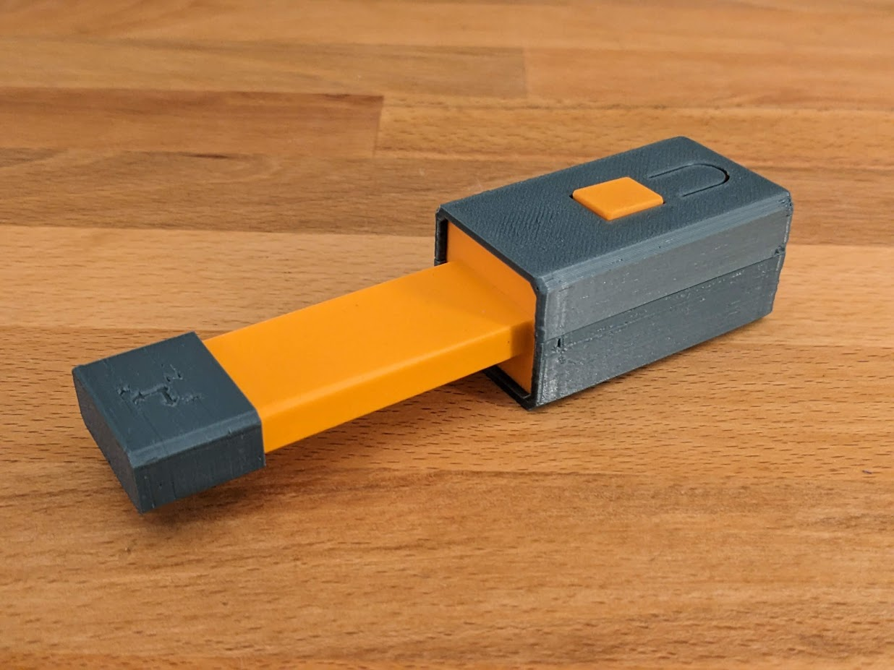
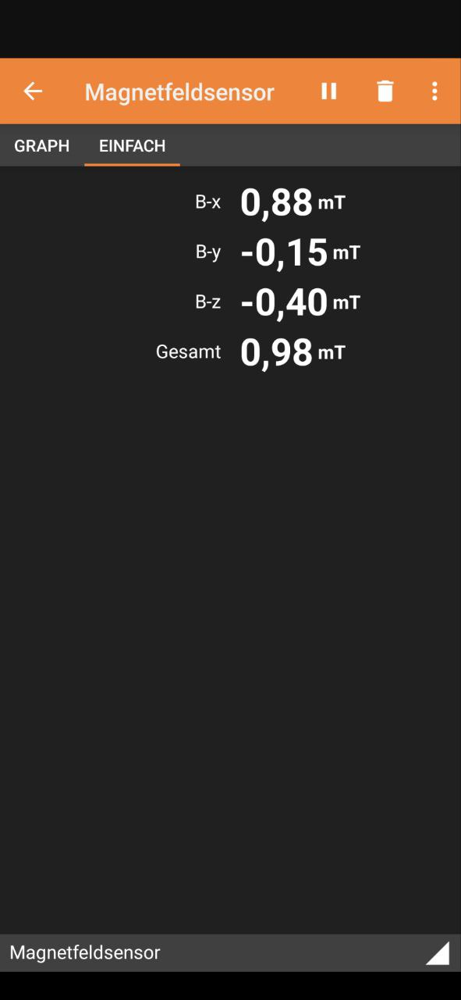
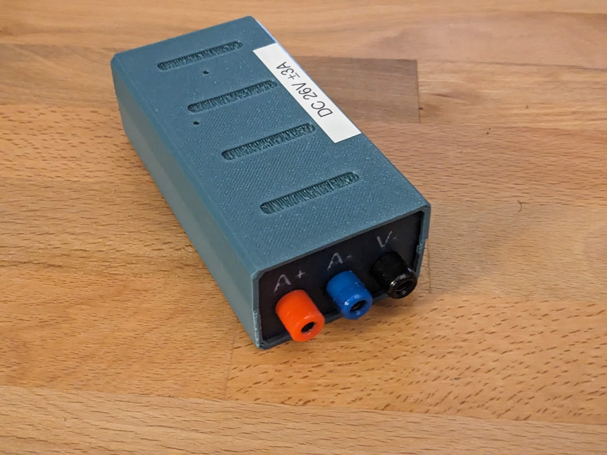
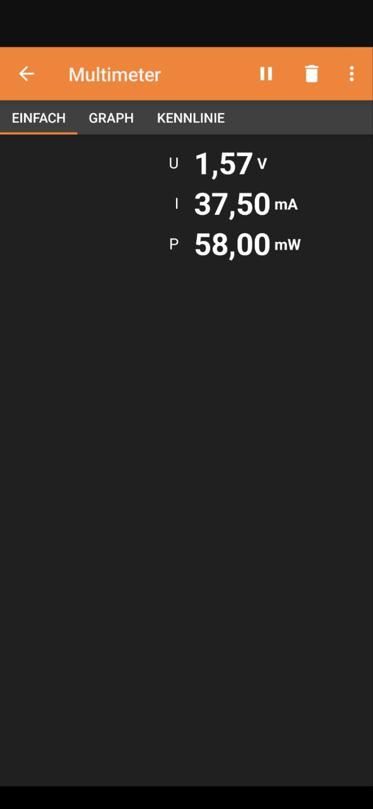

# BLE Sensors for Physics Classes

* [Goal](#goal)
* [Microcontroller and Sensors](#sensors)
   * [Force Sensor](#force)
   * [ToF Distance Sensor](#tof)
   * [Light Gate](#gate)
   * [Magnetometer](#magnet)
   * [DC Multimeter](#multimeter)
   * [Barometer](#barometer)

## Goal 

The goal is to provide **easy-to-use**, affordable sensor boxes for digital data acquisition, suitable both for student experiments and for teacher demonstrations in physics lessons.

Each box can be assembled for less than €20.

Feedback and suggestions for improving the 3D files or the Arduino code are welcome.

## Microcontroller and Sensors 

All boxes are equipped with an ESP32, enabling them to communicate via BLE (Bluetooth Low Energy) or a serial connection. Measurements are displayed and recorded with the free [phyphox](https://phyphox.org) app.

I use the LOLIN32 Lite development board because it is widely available, inexpensive, and has a built-in battery connector.

Most sensors use the I²C interface to communicate with the ESP32.

### Force Sensor 

Sensor:

Load cell and HX711 amplifier

### ToF Distance Sensor 

Sensor:

VL53L0X

or

VL53L1X

[Assembly instructions: see wiki](https://github.com/HeiLaut/ble-physics-sensors/wiki/Laser-Distance)

### Light Gate 

Sensor:

Adafruit IR break beam sensor

or (cheaper)

modified LM393 light gate / speed sensor module

### Magnetometer 

Sensor:

LIS2MDL

or

MLX90393

or

GY-271 (low range)

### DC Multimeter 

Sensor:

INA219

and (optional)

ADS1115

Example videos:

I–V characteristic curve of a diode: https://youtu.be/DQ5L0hsJfBA

I–V characteristic curve of a resistor: https://youtu.be/PSxBtcULFwU

Charging and discharging a capacitor: https://youtube.com/shorts/HkM0g7PQ94s

### Barometer 

Sensor:

BMP180 barometer and thermometer module
